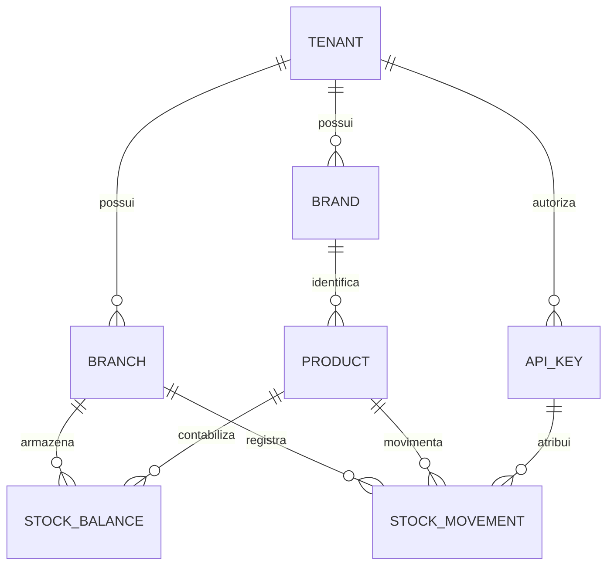

# Arquitetura inicial

Decisao inicial: monolito modular em Go, HTTP/JSON com `net/http`, PostgreSQL e driver pgx. Uma aplicacao, um banco, transacoes locais. A interface web sera adicionada depois das regras de acesso. O nome do repositorio foi usado como ponto de partida para a escolha de Go; a stack nao era preexistente no repo.

## Dados e limites

`tenant` representa uma empresa ou grupo operacional; `branch` representa uma loja. Dentro do tenant, marca e produto sao compartilhados, enquanto o saldo pertence ao par loja/produto. O modelo aceita quatro lojas ou outras quantidades, sem inventar seus nomes. Outra empresa recebe outro tenant e outras credenciais.

IDs UUID sao chaves internas. SKU interno e codigo do fabricante nao sao intercambiaveis. A restricao comercial e `(tenant, marca, codigo normalizado)`, e SKU e unico no tenant. A normalizacao preserva zeros, pontos, barras e sufixos; ajusta somente caixa e espacos. Busca textual usa indice trigram e listas com cursor e limite maximo de 100 itens.

Nesta etapa, o catalogo tecnico e privado por tenant. O reuso em empresas futuras deve acontecer por publicacao/importacao explicita de dados tecnicos revisados, com IDs de origem e evidencias. Quantidade, preco, custo, dados fiscais, fornecedores e dados de clientes nao fazem parte dessa publicacao. O fluxo ainda nao foi implementado.

OEMs, similares e aplicacoes ainda nao tem tabelas nem API. A etapa correspondente deve separar referencia original, equivalencia, substituicao, configuracao de veiculo, fonte e evidencia. Associacao provavel nao equivale a compatibilidade confirmada. Isso evita guardar uma lista livre de modelos como se fosse evidencia.

## Estoque

Uma requisicao de movimento recebe chave de idempotencia unica por tenant. O banco insere o movimento dentro da transacao. A restricao unica serializa pedidos com a mesma chave; uma repeticao le o resultado original e compara seu conteudo. O saldo e atualizado atomicamente com uma condicao de disponibilidade; o PostgreSQL bloqueia a linha enquanto concorre com outra atualizacao. Qualquer falha desfaz movimento e saldo juntos.

O saldo atual e uma projecao do razao de movimentos. Nao existe endpoint para edita-lo diretamente. `balance_after` e o saldo historico depois daquela operacao, nao o saldo atual em uma retentativa posterior. Saldo negativo novo e impedido; importacao de um saldo negativo de outro ERP tera tratamento de anomalia proprio, sem "corrigir" a origem por inferencia.

Unidades sao inteiras `UN`. Precos, custos, fracionamento, embalagens, reservas, estornos e transferencias nao estao nesta etapa. Nao adaptar ponto flutuante ao estoque ou ao financeiro sem um contrato de precisao.

## Acesso e operacao

Toda rota de dados exige chave aleatoria de 256 bits. O banco armazena SHA-256 da chave, tenant e perfil. A chave pode ser revogada. Admin gerencia lojas e todos os cadastros; cataloger cadastra marcas e produtos; stock lanca movimentos; reader consulta. Todos esses perfis podem consultar todas as lojas do proprio tenant nesta versao. Permissao por loja e login de pessoas ainda nao existem.

O tenant vem da credencial, nunca do corpo da requisicao. Consultas filtram o tenant e FKs compostas impedem relacoes cruzadas. Nao ha RLS implementado: o banco deve ficar privado, acessivel apenas pela aplicacao, e a separacao e aplicada pelo backend e pelas restricoes relacionais. Credenciais administrativas do banco nao podem ser entregues a clientes ou ao navegador.

Migrations sao uma acao explicita da CLI, com lock de transacao e checksum. A API nao cria schema ao iniciar. Dados reais nao pertencem ao Git. Copias de seguranca ficam em armazenamento privado; migracoes nao substituem backups. Nao ha sincronizacao automatica com o ERP atual nem migracao de lojas realizada.

Antes de producao: identidade por operador e expiracao/rotacao de credenciais, permissao por loja, TLS e controle de acesso na borda, usuario de banco restrito, trilha administrativa, backup/restauracao ensaiados, observabilidade e plano de retorno da migracao. Estes pontos devem ser entregas verificaveis, nao apenas textos de instrucao para a IA.

## Fontes tecnicas

- [Go: acesso a bancos relacionais](https://go.dev/doc/tutorial/database-access)
- [pgxpool](https://pkg.go.dev/github.com/jackc/pgx/v5/pgxpool)
- [PostgreSQL: bloqueios de linha](https://www.postgresql.org/docs/current/explicit-locking.html)
- [GitHub Pages: limites de uso](https://docs.github.com/en/pages/getting-started-with-github-pages/github-pages-limits)
