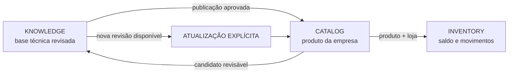
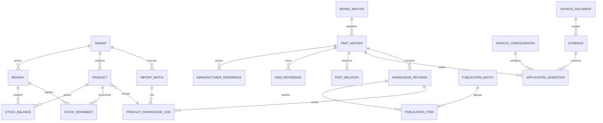
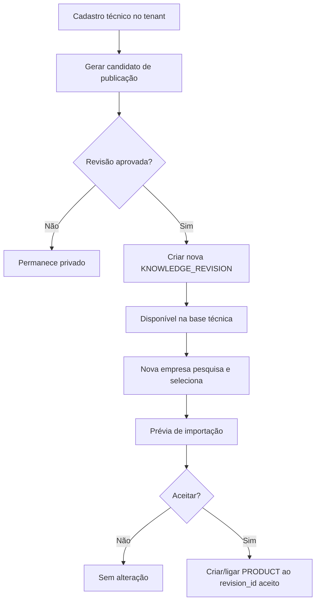

# Base técnica reutilizável entre empresas

## Objetivo

Preservar o conhecimento acumulado em cadastros de autopeças e reaproveitá-lo em empresas futuras sem misturar dados operacionais, comerciais ou sigilosos entre tenants.

O PostgreSQL continua sendo a fonte de verdade dos dados da aplicação. O GitHub guarda código, migrações, contratos, documentação e artefatos de desenvolvimento; não recebe estoque real, preços, custos, clientes, documentos fiscais ou credenciais.

A arquitetura separa três limites:

1. `knowledge`: conhecimento técnico reutilizável e versionado.
2. `catalog`: produto cadastrado dentro de uma empresa e sua ligação explícita com o conhecimento técnico.
3. `inventory`: saldo e razão de movimentos por loja, sempre privados ao tenant.

## Regra principal de isolamento

Conhecimento técnico pode ser reutilizado. Dados operacionais não.

Nunca entram em `knowledge`:

- saldo, quantidade, custo, preço ou margem;
- fornecedor, cliente, pedido, venda, compra ou financeiro;
- documento fiscal;
- credencial, operador ou permissão;
- qualquer dado que identifique a operação comercial de outro tenant.

O reuso entre empresas é sempre explícito e auditável. Uma alteração na base global não muda silenciosamente um cadastro já aceito por uma empresa.

## Modelo lógico

## Entidades de conhecimento

### `brand_master`

Marca/fabricante técnico reutilizável. Não substitui automaticamente a marca comercial cadastrada no tenant.

Campos mínimos:

- `id UUID` estável;
- `name`;
- `normalized_name`;
- `status` (`active`, `merged`, `deprecated`);
- `created_at`.

### `part_master`

Identidade técnica canônica da peça. Não contém SKU, saldo, preço ou custo.

Campos mínimos:

- `id UUID` estável;
- `brand_master_id`;
- `manufacturer_code_raw`;
- `manufacturer_code_normalized`;
- `canonical_name`;
- `position`, `side`, `system` quando aplicável;
- `current_revision_id`;
- `status`.

A unicidade forte deve partir de marca + código normalizado dentro da base técnica. Códigos iguais em marcas diferentes continuam válidos.

### `manufacturer_reference`

Códigos do próprio fabricante da peça, inclusive referências antigas e substituídas. Preserva o valor original e a forma normalizada usada para busca.

### `oem_reference`

Referência original de montadora. OEM não cria aplicação automaticamente.

Campos mínimos:

- `automaker`;
- `code_raw`;
- `code_normalized`;
- `relation_type` (`original`, `supersedes`, `superseded_by`);
- `status`;
- `evidence_id`.

### `vehicle_configuration`

Representa a configuração que realmente decide compatibilidade: geração, chassi, motor, eixo, suspensão, freio, câmbio, número de saídas, textura, lado ou outra característica técnica relevante.

Não usar uma lista livre de nomes de veículos como prova de aplicação.

### `application_assertion`

Afirmação versionada de aplicação. Deve referenciar configuração e evidência.

Estados:

- `pending`: pista ainda não confirmada;
- `confirmed`: sustentada pela regra de evidência do projeto;
- `rejected`: hipótese analisada e descartada;
- `superseded`: substituída por revisão posterior.

Uma aplicação confirmada nunca nasce apenas de associação provável, nome parecido ou motor semelhante.

### `part_relation`

Relações entre peças, tipadas explicitamente:

- `equivalent`;
- `supersedes` / `superseded_by`;
- `variant`;
- `pair_left_right`;
- `kit_component`;
- `similar_not_interchangeable`.

Isso impede tratar qualquer referência parecida como similar real.

### `source_document` e `evidence`

A evidência deve ser recuperável e auditável.

`source_document` guarda metadados da origem: tipo, URL ou identificador, fabricante/montadora, título, versão/data quando disponível e checksum quando o arquivo foi incorporado legalmente ao processo.

`evidence` aponta para o trecho útil: página, seção, tabela, código, observação e data de captura. Uma revisão posterior pode invalidar ou substituir a evidência sem apagar o histórico.

## Revisões e histórico

`knowledge_revision` é append-only. Corrigir conhecimento técnico significa criar nova revisão, não sobrescrever silenciosamente a anterior.

Campos mínimos:

- `part_master_id`;
- `revision_no` monotônico por peça;
- `snapshot` do conjunto técnico normalizado ou referências para as entidades versionadas;
- `change_reason`;
- `created_by`;
- `created_at`.

O `part_master.current_revision_id` funciona como ponteiro conveniente para leitura atual. Revisões antigas permanecem consultáveis.

## Publicação e importação

O fluxo de reaproveitamento é deliberado:

### `product_knowledge_link`

Liga o cadastro privado da empresa à revisão técnica aceita.

Campos mínimos:

- `tenant_id`;
- `product_id`;
- `part_master_id`;
- `accepted_revision_id`;
- `import_batch_id` quando houver;
- `linked_at`;
- `linked_by`.

Quando surgir uma revisão técnica nova, a interface mostra `update_available`. A aplicação não muda automaticamente a revisão aceita pelo tenant.

### `publication_batch`

Agrupa uma publicação da base privada para a base técnica. Registra autor, motivo, origem, versão anterior e versão resultante.

### `import_batch`

Agrupa o reuso por uma empresa. Deve suportar prévia, rejeições por item, retentativa idempotente e relatório final.

## Duplicidades e merges

Deduplicação automática só é permitida para chaves determinísticas já normalizadas. Casos aproximados viram candidatos de revisão.

Nunca apagar um ID técnico que já foi referenciado. Um merge cria um evento com:

- `survivor_id`;
- `absorbed_id`;
- motivo;
- evidência;
- autor;
- data.

Consultas por IDs ou referências antigas continuam resolvendo para o registro sobrevivente.

## Empresa, filial e CNPJ

CNPJ deve ser tratado como texto, nunca como número. Desde julho de 2026 novas inscrições podem ser alfanuméricas; CNPJs existentes continuam válidos.

Recomendação:

- `tax_id_raw`: forma recebida/exibida;
- `tax_id_normalized`: letras e dígitos em maiúsculas, sem pontuação;
- restrição única no escopo apropriado;
- validação de formato/check digits isolada em função própria, sem converter para inteiro.

Fonte oficial: https://www.gov.br/receitafederal/pt-br/assuntos/noticias/2026/julho/receita-federal-gera-o-primeiro-cnpj-em-formato-alfanumerico

## RLS e segurança

RLS protege tabelas privadas por tenant, mas só funciona quando ativada na tabela e acompanhada de policies adequadas. Roles de runtime não devem ser donas das tabelas nem possuir privilégios que contornem a política.

A base `knowledge` pode ser legível pelos tenants autorizados, mas escrita apenas pelo fluxo de revisão/publicação. Tabelas `catalog`, `inventory`, identidade e operação continuam filtradas por tenant.

Fonte oficial PostgreSQL 18: https://www.postgresql.org/docs/18/sql-createpolicy.html

## Busca

A busca precisa aceitar:

- código exato do fabricante;
- OEM;
- SKU local;
- nome/descrição;
- marca;
- configuração/veículo;
- referência antiga/substituída.

Prioridade de resultado recomendada:

1. igualdade exata normalizada;
2. alias/referência conhecida;
3. prefixo;
4. similaridade textual como pista.

Similaridade textual nunca confirma equivalência técnica nem aplicação.

## Contrato para a interface

A interface deve deixar visíveis quatro estados diferentes:

- `LOCAL`: dado somente daquela empresa;
- `LINKED`: cadastro local ligado a uma revisão técnica;
- `UPDATE AVAILABLE`: existe revisão posterior, ainda não aceita;
- `PENDING REVIEW`: candidato ainda não publicado/revisado.

A ficha da peça deve separar visualmente:

1. identidade da peça;
2. referências de fabricante;
3. OEMs;
4. aplicações/configurações;
5. similares/substituições;
6. fontes/evidências;
7. histórico de revisões;
8. vínculo com empresas/lojas, sem expor dados comerciais de outros tenants.

## Critérios de aceitação

- Duas empresas podem reutilizar a mesma `knowledge_revision` sem compartilhar estoque ou dados comerciais.
- Atualização da base técnica não altera silenciosamente cadastros já aceitos.
- Todo dado importado informa origem, revisão e lote.
- Merge preserva IDs antigos e histórico.
- Aplicação confirmada exige configuração + evidência.
- OEM isolado não cria aplicação.
- Código igual em marcas diferentes não colide.
- CNPJ alfanumérico é aceito como texto.
- RLS impede leitura cruzada das tabelas privadas mesmo diante de erro de filtro na aplicação.
